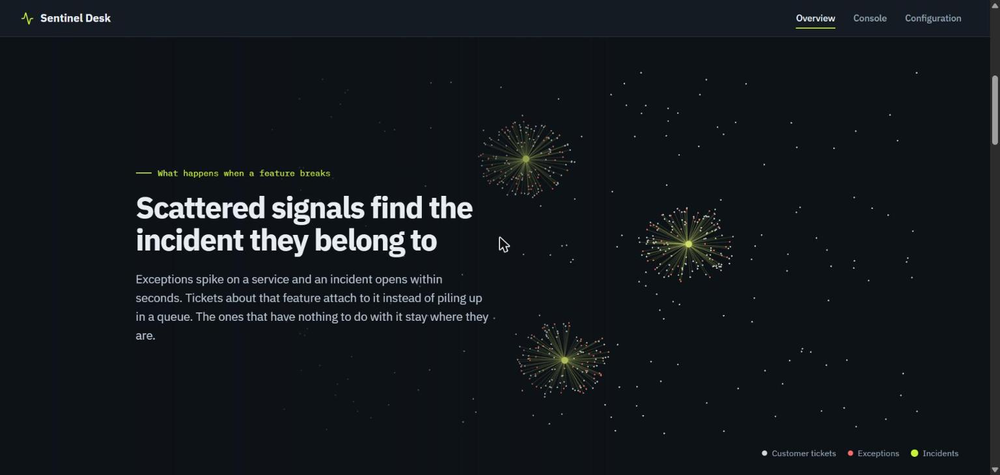
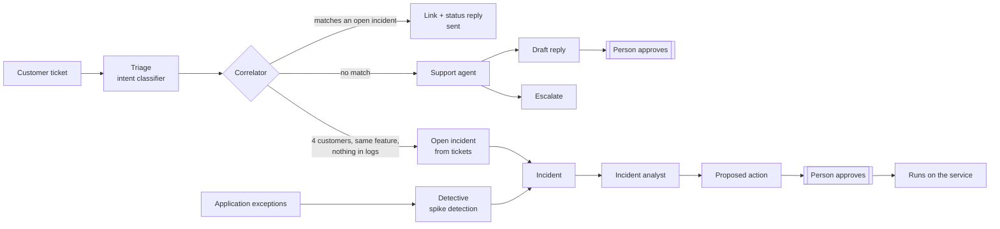
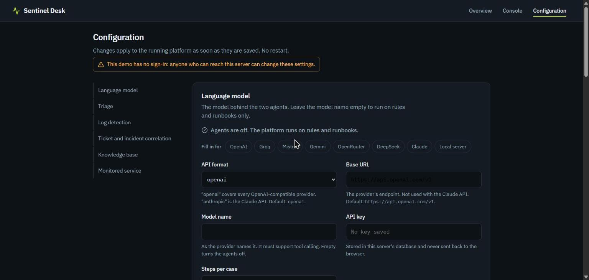

# Sentinel Desk

[](https://github.com/HAMMOUDAmustaphaahmed/sentinel-desk/actions/workflows/ci.yml)


**Twenty complaints. One incident.**

A support ticket and a log exception are often two views of the same problem. Sentinel Desk links them: when a feature breaks, the team investigates once, and every affected customer is told what is going on.



| Measured on unseen data | Result |
|---|---|
| Outages detected from logs | **100%**, median **7 s** after the first failure |
| Ticket-to-incident links that are correct | **98.9%** |
| Silent failures detected from tickets alone | **97.3%**, after a median of **4** complaints |
| Intent accuracy over 77 banking intents | **91.6%** |

Every figure is reproduced by one script. See [Results](#results) for what they cover and what they do not.

## Contents

- [What it does](#what-it-does)
- [Features](#features)
- [Tech stack](#tech-stack)
- [Architecture](#architecture)
- [Engineering decisions](#engineering-decisions)
- [Results](#results)
- [Run it](#run-it)
- [Configuration reference](#configuration-reference)
- [API reference](#api-reference)
- [Tests](#tests)
- [Deploy](#deploy)
- [Limits](#limits)

## What it does

It works in both directions:

- **An outage shows in the logs.** Exceptions spike on a service, an incident opens within seconds, and every ticket about that feature is linked to it and answered with its status.
- **A failure shows nowhere in the logs.** Several customers report the same feature failing while no exception is logged. The platform opens an incident from the tickets alone. Monitoring did not see it; the support queue did.

Each incident gets a likely cause and one proposed recovery action. Nothing runs until a person approves it.


## Features

**Tickets**

- Intent classification over 77 banking intents, with a calibrated confidence
- Automatic linking of a ticket to the open incident it reports
- Retroactive linking: tickets sent shortly before detection fires are adopted by the incident
- A status reply sent to each linked customer, citing the incident
- Draft replies from a knowledge base of 14 articles, with their sources named
- Edit-then-approve, or reject and hand to an engineer
- Escalation when the classifier is unsure or nothing matches
- A step-by-step trace on every ticket: who decided what, and why

**Incidents**

- Spike detection against each service's own baseline
- New-error detection: an error type never seen before needs only three occurrences
- Exception fingerprinting that ignores ids, amounts and timings, so one bug is one group
- Incidents opened from ticket clusters, counting distinct customers, when the logs are silent
- A likely cause and one proposed action per incident, from an agent or from a runbook
- Automatic resolution after a quiet period, and reopening if a fix does not hold
- Exceptions-per-minute sparkline over the last 30 minutes

**Agents**

- A support agent and an incident analyst, each a tool-calling loop with lookup tools
- Works with any OpenAI-compatible API (OpenAI, Groq, Mistral, Gemini, OpenRouter, DeepSeek, local servers) and with Claude
- Runs with no model at all: rules and runbooks take over
- Automatic fallback when the model errors, refuses, or reaches no decision

**Safety**

- Human approval for every model-written reply and every recovery action
- An allowlist of three actions; no free-form command exists
- Agent decisions validated by code before they count
- Customer text passed to the model as delimited data
- An append-only audit log of every automatic and human decision

**Configuration, at runtime**

- 18 settings editable from the browser, applied without a restart
- Provider shortcuts and a connection test for the model
- A write-only API key: stored server-side, never returned to the browser
- Server-side validation, with the same rules driving the form

**Demonstration**

- A fake online bank with six features and background traffic
- Fault injection in two modes: exceptions, or silent failure with no logs
- Sample tickets drawn from real customer phrasings
- One-click reset

**Interface**

- An overview page with a scroll-driven Three.js scene
- A live console, refreshed every two seconds
- Keyboard navigation, visible focus, labelled controls, reduced-motion support
- Layouts for desktop, tablet and phone

## Tech stack

| Area | Technologies | Where to look |
|---|---|---|
| Backend | Python, FastAPI, Pydantic, SQLAlchemy 2.0, SQLite or PostgreSQL | [`sentineldesk/api.py`](sentineldesk/api.py), [`db.py`](sentineldesk/db.py) |
| Machine learning | scikit-learn: TF-IDF over word and character n-grams, logistic regression | [`triage.py`](sentineldesk/triage.py), [`scripts/evaluate.py`](scripts/evaluate.py) |
| AI agents | Tool calling, a validated decision loop, provider adapters, prompt-injection hygiene | [`agent.py`](sentineldesk/agent.py), [`llm.py`](sentineldesk/llm.py), [`supervisor.py`](sentineldesk/supervisor.py) |
| Detection | Exception fingerprinting, rate-against-baseline spike detection | [`detective.py`](sentineldesk/detective.py) |
| Frontend | React 18, TypeScript (strict), Vite, React Router | [`web/src`](web/src) |
| Motion and 3D | Framer Motion, Three.js with React Three Fiber | [`SignalScene.tsx`](web/src/components/landing/SignalScene.tsx) |
| Testing | pytest, FastAPI TestClient, httpx mock transport, scripted model | [`tests/`](tests) |
| Delivery | Docker, Docker Compose, nginx, GitHub Actions | [`Dockerfile`](Dockerfile), [`.github/workflows/ci.yml`](.github/workflows/ci.yml) |

About 3,000 lines of Python and 2,750 of TypeScript and CSS, tests included.

## Architecture



| Part | What it does | How |
|---|---|---|
| Triage | Finds which of 77 intents a ticket is about, and how sure it is | A linear classifier. No model API call |
| Detective | Opens an incident when exceptions spike or a new error type appears | Counting against the service's own baseline |
| Correlator | Links tickets to incidents; opens an incident from a cluster of complaints | Rules on feature, time window and confidence |
| Support agent | Handles tickets no incident explains: links, drafts a reply, or escalates | A language model with lookup tools |
| Incident analyst | Reads exceptions, tickets and runbooks; proposes one recovery action | A language model with lookup tools |
| Supervisor | Routes each ticket and incident to the right part | Ordinary code |

## Engineering decisions

**Deterministic first, model second.** Detection must fire in seconds and must never invent an incident, so it is plain counting. Routing a ticket costs nothing, because a small classifier does it. The model is called only for the tickets and incidents that need judgement.

**An agent ends on a decision that code validates.** Each agent has lookup tools and a few decision tools. A decision is checked before it counts: a reply must cite articles that exist, a link must point to an open incident, an action must be on the allowlist. A rejected decision returns to the model as an error, so it can correct itself. See [`agent.py`](sentineldesk/agent.py), 90 lines.

**The model never has the last word.** Its replies wait for a person. Its proposed actions wait for a person. The one automatic reply is a fixed sentence stating a known fact.

**Provider-neutral by construction.** The agent loop sees three methods: `start`, `complete`, `add_results`. Two adapters implement them, one for the OpenAI-compatible wire format and one for the Claude API. Adding a provider with a third format means one more class.

**Low confidence is measured, not guessed.** Below 35% confidence the classifier is right 47% of the time; above it, 94%. That measurement is why tickets under the threshold are never handled automatically.

**Settings are described once.** [`runtime_config.py`](sentineldesk/runtime_config.py) lists every editable setting with its type, range and help text. The API validates against that list and the configuration page renders from it, so the two cannot drift apart.

**Time is a parameter.** Every function that depends on the clock takes `now`. Tests and the 300-scenario evaluation run on a fake clock, in memory, with no sleeping.

**Lexical search, on purpose.** The knowledge base has 23 short documents. TF-IDF is deterministic and sufficient at that size, and an agent that wants a second angle can search again. Embeddings would be the next step for a larger base.

## Results

Measured by `python -m scripts.evaluate`; full output in [`docs/evaluation.json`](docs/evaluation.json).

**Triage**, on the 3,080 Banking77 test tickets the classifier never saw:

| Measure | Result |
|---|---|
| Intent accuracy (77 intents) | 91.6% |
| Affected feature correct | 96.6% |
| "Reports a failure" flag correct | 97.2% |
| Accuracy when confidence is below the 35% threshold (4.7% of tickets) | 47.2% |
| Accuracy above the threshold | 93.8% |

**Incidents**, over 300 simulated scenarios on a fake clock: background noise in the logs, then an outage or a silent failure, with real test-split tickets arriving around it, mixed with unrelated ones.

| Measure | Result |
|---|---|
| Tickets linked to the right incident (recall) | 87.3% (2,597 of 2,976) |
| Links that were correct (precision) | 98.9% (29 wrong links) |
| Outages detected from logs | 100% of 227, median 7 s after the first failure |
| Silent failures detected from tickets alone | 97.3% of 73, after a median of 4 complaints |
| False incidents | 0.05 per scenario |

### What these numbers do not cover

- **No language model was involved.** They measure the deterministic path every ticket takes first. The two agents are tested with a scripted model, not evaluated against a real one, because no API key was available when this was built.
- **"Which tickets belong to the incident" is defined by this project's own intent-to-feature mapping.** A ticket counts as related when its true Banking77 label maps to the broken feature and reports a failure.
- **The scenarios are simulated.** Real traffic has seasonality and correlated failures across services, which the simulation does not.

## Run it

You need Python 3.10+ and Node 20+.

```bash
python -m venv .venv
.venv\Scripts\activate            # macOS / Linux: source .venv/bin/activate
pip install -r requirements-dev.txt

python -m scripts.fetch_data      # downloads Banking77 (about 1 MB)
python -m scripts.train           # trains the triage model, about 30 s
```

Then three terminals:

```bash
uvicorn sentineldesk.api:app --port 8000      # the platform
uvicorn bank.app:app --port 8100              # the demo bank it watches
cd web && npm install && npm run dev          # the interface, http://localhost:5174
```

Or with Docker (not tested on the machine this was built on):

```bash
docker compose up --build         # http://localhost:8080
```

### Try it

1. Open the **Console**. In **Demo controls**, pick `transfers` and click **Break it (raises exceptions)**. An incident opens within a few seconds.
2. Click **5 customers complain**. The tickets are linked to the incident and answered.
3. Click **Approve and run** on the proposed action. The demo bank is repaired and the incident moves to "Fix applied, watching".
4. Pick `topup`, click **Break it silently**, then **5 customers complain**. No exception is logged, and an incident still opens, from the tickets.

### Turn the agents on

Open **Configuration**, pick a provider shortcut, enter the model name and your key, save, then click **Test the connection**. The change applies at once. The model must support tool calling.

With a hosted model, ticket text leaves your network. For data that cannot, point the base URL at a model you host.

## Configuration reference

All of these can be changed on the Configuration page while the platform runs. The environment variable of the same name in upper case sets the starting value for the model settings and the service URL.



| Setting | Default | Meaning |
|---|---|---|
| `llm_provider` | `openai` | `openai` for any OpenAI-compatible API, `anthropic` for Claude |
| `llm_base_url` | `https://api.openai.com/v1` | The provider's endpoint |
| `llm_model` | empty | Model name. Empty turns the agents off |
| `llm_api_key` | empty | Write-only |
| `agent_max_steps` | 8 | Tool-calling rounds an agent may take on one case |
| `min_confidence` | 0.35 | Below this, a ticket is never handled automatically |
| `spike_window_s` | 120 | How far back "right now" looks |
| `baseline_window_s` | 1800 | The period that defines what is normal for a service |
| `spike_min_events` | 5 | Fewer exceptions than this is never an incident |
| `spike_ratio` | 3 | The window's rate must be this many times the baseline |
| `new_error_min_events` | 3 | Occurrences of a never-seen error needed to open an incident |
| `quiet_resolve_s` | 300 | No new exception for this long resolves the incident |
| `link_before_s` | 600 | Tickets sent this long before detection are still linked |
| `link_after_s` | 1800 | Tickets sent this long after the last exception are still linked |
| `cluster_window_s` | 900 | Complaints this recent count towards a ticket-driven incident |
| `cluster_min_customers` | 4 | Distinct customers needed to open one |
| `min_retrieval_score` | 0.2 | Below this match, no reply is drafted |
| `bank_url` | `http://127.0.0.1:8100` | Where approved actions are sent |

Set only in the environment: `DATABASE_URL` (any SQLAlchemy URL), `CORS_ORIGINS`, and `VITE_API_URL` for the interface when the platform is hosted elsewhere.

## API reference

Interactive documentation is served at `/api/docs`.

| Method and path | Purpose |
|---|---|
| `POST /api/ingest/exceptions` | Receive a batch of exception events |
| `POST /api/tickets` | Submit a ticket; returns its routing, reply and trace |
| `GET /api/overview` | Counts, incidents and recent tickets for the console |
| `POST /api/tickets/{id}/decision` | Approve (optionally edited) or reject a drafted reply |
| `POST /api/actions/{id}/decision` | Approve or reject a proposed action |
| `GET /api/audit` | The audit log |
| `GET /api/config`, `PUT /api/config` | Read and change settings |
| `POST /api/config/reset` | Back to defaults |
| `POST /api/config/test-model` | One short request to the configured model |
| `GET /api/health` | Liveness |
| `/api/demo/*` | Fault injection, sample tickets, reset |

## Tests

```bash
python -m pytest -q               # 34 tests, about 2 s, no network, no dataset
cd web && npm run build           # type-checks and builds the interface
```

The tests train a tiny classifier of their own and drive the agents with a scripted model, so they need neither the dataset nor an API key. CI runs both commands on every push.

## Deploy

The interface is static and deploys to Vercel. The platform and the demo bank are long-running Python services with a database and a background loop, which a serverless host cannot run, so they go to a container or VM host. A Render blueprint is included. This split has not been deployed from this repository yet.

1. **Python services.** On Render, create a Blueprint from this repository; [`render.yaml`](render.yaml) defines both services. Once they have URLs, set `PLATFORM_URL` on the bank and `BANK_URL` on the platform.
2. **Interface.** On Vercel, import the repository, set the root directory to `web`, and add the environment variable `VITE_API_URL` with the platform's URL.
3. **Allow the interface.** Set `CORS_ORIGINS` on the platform to the Vercel URL.

Free instances sleep when idle, so the first request after a pause takes about a minute. SQLite on a free instance is not persistent; for durable data set `DATABASE_URL` to a PostgreSQL database.

## Layout

```
sentineldesk/
  triage.py          intent classifier
  intents.py         intent -> feature, and "is this a failure"
  detective.py       exception fingerprints and spike detection
  correlator.py      ticket <-> incident linking, ticket clusters
  agent.py           the tool-calling loop, with validated decisions
  llm.py             provider adapters
  actions.py         the action allowlist and approval
  supervisor.py      routing, the two agents' tools and prompts
  knowledge.py       runbook and FAQ search
  runtime_config.py  settings editable while running, and their validation
  api.py             HTTP API
bank/app.py          the demo bank, with fault injection
runbooks/  faq/      the knowledge base, as Markdown
scripts/             fetch_data, train, evaluate
tests/
web/                 React + TypeScript: overview, console, configuration
```

## Limits

- **No authentication.** This is a demo, and that includes the configuration page. Put it behind your own sign-in before exposing it.
- **One open incident per service.** Two unrelated failures on the same service are treated as one.
- **Tickets are English only**, like the dataset.
- **Detection thresholds are set by hand**, the same for every service. They are not learned.
- **Knowledge-base search is lexical.** A larger base would need embeddings.
- **The agents have not been evaluated against a real model**, only tested with a scripted one.

## Data and licence

Tickets come from [Banking77](https://github.com/PolyAI-LDN/task-specific-datasets) (PolyAI, CC BY 4.0): Casanueva et al., *Efficient Intent Detection with Dual Sentence Encoders*, 2020. The dataset is downloaded by a script and is not redistributed here.

Code: MIT.

## Author

Ahmed Mustapha Hammouda · [LinkedIn](https://www.linkedin.com/in/ahmed-mustapha-hammouda-a55270195/) · [GitHub](https://github.com/HAMMOUDAmustaphaahmed)
