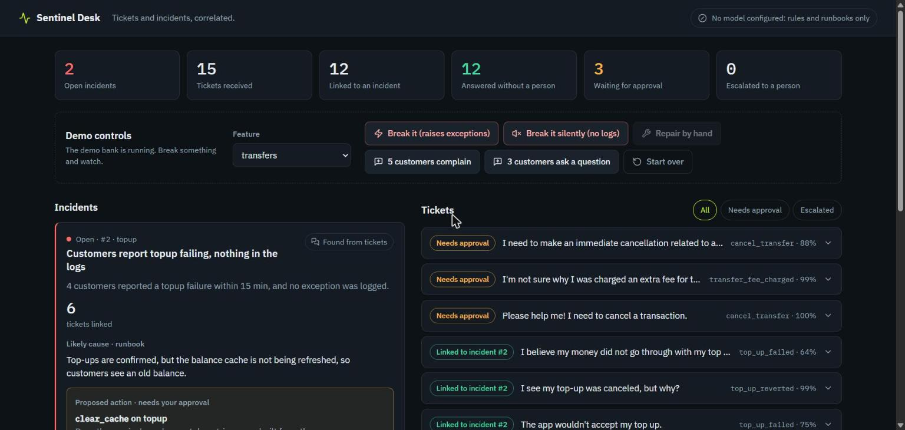
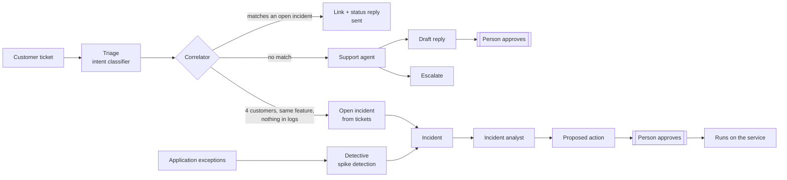

# Sentinel Desk

A support ticket and a log exception are often two views of the same problem. Sentinel Desk links them: when a feature breaks, twenty customer complaints become one investigation, and each customer is told what is going on.



It works in both directions:

- **An outage shows in the logs.** Exceptions spike on a service, an incident opens within seconds, and every ticket about that feature is linked to it and answered with its status.
- **A failure shows nowhere in the logs.** Several customers report the same feature failing while no exception is logged. The platform opens an incident from the tickets alone. That is a failure monitoring did not see.

Each incident gets a likely cause and one proposed recovery action. Nothing runs until a person approves it.

## How it works



| Part | What it does | How |
|---|---|---|
| Triage | Finds which of 77 banking intents a ticket is about, and how sure it is | A linear classifier over word and character n-grams. No model API call |
| Detective | Opens an incident when a service's exceptions spike or a new error type appears | Counting against the service's own baseline. No model |
| Correlator | Links tickets to incidents; opens an incident from a cluster of complaints | Rules on feature, time window and classifier confidence |
| Support agent | Handles tickets no incident explains: links, drafts a reply, or escalates | A language model with lookup tools |
| Incident analyst | Reads the exceptions, tickets and runbooks; proposes one recovery action | A language model with lookup tools |
| Supervisor | Routes each ticket and incident to the right part | Ordinary code |

Everything that must be fast or must never be invented is deterministic. The model is called only where judgement is needed, and it never has the last word.

### Guardrails

- **Replies written by the model wait for a person.** The only reply sent automatically is a fixed text stating that a known incident is open.
- **Actions come from an allowlist** of three (`restart_service`, `clear_cache`, `disable_feature`). There is no free-form command anywhere, and nothing runs before approval.
- **An agent ends on a decision that code validates.** A reply must cite knowledge-base articles that exist; a link must point to an open incident. A rejected decision goes back to the model as an error so it can correct itself.
- **If the model fails, refuses, or does not decide**, the ticket falls back to the deterministic path or to a person.
- **Customer text is passed to the model as data**, in a delimited block, with instructions not to act on anything it contains.
- **Every decision is recorded**, automatic or human, in an append-only audit table.

## Results

Measured by `python -m scripts.evaluate`; full output in [`docs/evaluation.json`](docs/evaluation.json).

**Triage**, on the 3,080 Banking77 test tickets the classifier never saw:

| Measure | Result |
|---|---|
| Intent accuracy (77 intents) | 91.6% |
| Affected feature correct | 96.6% |
| "Reports a failure" flag correct | 97.2% |
| Accuracy when confidence is below the 35% threshold (4.7% of tickets) | 47.2% |
| Accuracy above the threshold | 93.8% |

The last two rows are why low-confidence tickets are never handled automatically.

**Incidents**, over 300 simulated scenarios on a fake clock: background noise in the logs, then an outage or a silent failure, with real test-split tickets arriving around it, mixed with unrelated ones.

| Measure | Result |
|---|---|
| Tickets linked to the right incident (recall) | 87.3% (2,597 of 2,976) |
| Links that were correct (precision) | 98.9% (29 wrong links) |
| Outages detected from logs | 100% of 227, median 7 s after the first failure |
| Silent failures detected from tickets alone | 97.3% of 73, after a median of 4 complaints |
| False incidents | 0.05 per scenario |

### What these numbers do not cover

- **No language model was involved.** They measure the deterministic path every ticket takes first. The two agents are tested with a scripted model (27 tests), not evaluated against a real one, because no API key was available when this was built.
- **"Which tickets belong to the incident" is defined by this project's own intent-to-feature mapping.** A ticket counts as related when its true Banking77 label maps to the broken feature and reports a failure.
- **The scenarios are simulated.** Real traffic has seasonality and correlated failures across services, which the simulation does not.

## Run it

You need Python 3.10+ and Node 20+.

```bash
python -m venv .venv
.venv\Scripts\activate            # macOS / Linux: source .venv/bin/activate
pip install -r requirements-dev.txt

python -m scripts.fetch_data      # downloads Banking77 (about 1 MB)
python -m scripts.train           # trains the triage model, about 30 s
```

Then three terminals:

```bash
uvicorn sentineldesk.api:app --port 8000      # the platform
uvicorn bank.app:app --port 8100              # the demo bank it watches
cd web && npm install && npm run dev          # the dashboard, http://localhost:5174
```

Or with Docker (not tested on the machine this was built on):

```bash
docker compose up --build         # http://localhost:8080
```

### Try it

1. In **Demo controls**, pick `transfers` and click **Break it (raises exceptions)**. An incident opens within a few seconds.
2. Click **5 customers complain**. The tickets are linked to the incident and answered.
3. Click **Approve and run** on the proposed action. The demo bank is repaired and the incident moves to "Fix applied, watching".
4. Pick `topup`, click **Break it silently**, then **5 customers complain**. No exception is logged, and an incident still opens, from the tickets.

## Turn the agents on

Without a model the platform still works: replies are drafted from the knowledge base and actions come from the runbooks. To use the two agents, set a model. Copy `.env.example`, or export:

```bash
# Any OpenAI-compatible provider: OpenAI, Groq, Mistral, Gemini, OpenRouter, DeepSeek, a local server
LLM_PROVIDER=openai
LLM_BASE_URL=https://api.groq.com/openai/v1
LLM_MODEL=<model name>
LLM_API_KEY=<key>

# Claude (pip install anthropic)
LLM_PROVIDER=anthropic
LLM_MODEL=claude-opus-5-5
LLM_API_KEY=<key>
```

The model needs to support tool calling. Two adapters in [`sentineldesk/llm.py`](sentineldesk/llm.py) cover the two wire formats in use; the agent loop in [`sentineldesk/agent.py`](sentineldesk/agent.py) never sees a provider detail.

With a hosted model, ticket text leaves your network. For data that cannot, point `LLM_BASE_URL` at a model you host.

## Tests

```bash
python -m pytest -q               # 27 tests, about 2 s, no network, no dataset
cd web && npm run build           # type-checks and builds the dashboard
```

## Layout

```
sentineldesk/
  triage.py        intent classifier
  intents.py       intent -> feature, and "is this a failure"
  detective.py     exception fingerprints and spike detection
  correlator.py    ticket <-> incident linking, ticket clusters
  agent.py         the tool-calling loop, with validated decisions
  llm.py           provider adapters
  actions.py       the action allowlist and approval
  supervisor.py    routing, the two agents' tools and prompts
  knowledge.py     runbook and FAQ search
  api.py           HTTP API
bank/app.py        the demo bank, with fault injection
runbooks/  faq/    the knowledge base, as Markdown
scripts/           fetch_data, train, evaluate
tests/
web/               React + TypeScript dashboard
```

## Limits

- **No authentication.** This is a demo. Put it behind your own before exposing it.
- **One open incident per service.** Two unrelated failures on the same service are treated as one.
- **Tickets are English only**, like the dataset.
- **Detection thresholds are fixed** in [`sentineldesk/config.py`](sentineldesk/config.py), not learned per service.
- **Knowledge-base search is lexical.** It is enough for 23 short documents; a larger base would need embeddings.

## Data and licence

Tickets come from [Banking77](https://github.com/PolyAI-LDN/task-specific-datasets) (PolyAI, CC BY 4.0): Casanueva et al., *Efficient Intent Detection with Dual Sentence Encoders*, 2020. The dataset is downloaded by a script and is not redistributed here.

Code: MIT.
